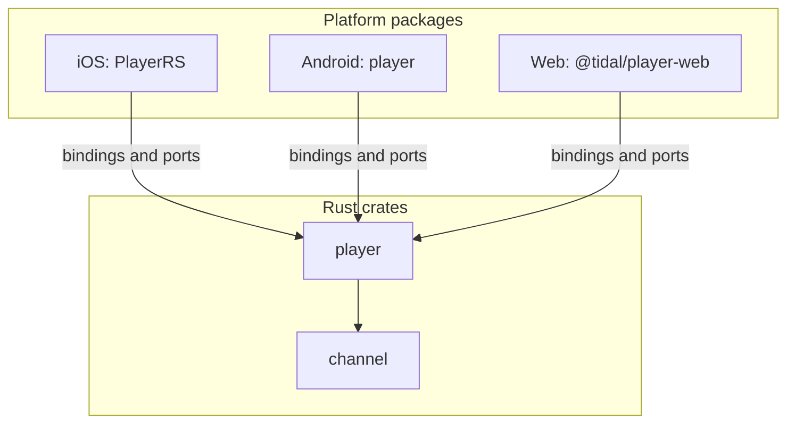

# TIDAL SDK

The TIDAL SDK provides TIDAL client business logic as shared Rust crates that run on iOS,
Android and the web. Each crate owns the logic every platform would otherwise duplicate;
the host app injects platform capabilities, such as HTTP, credentials, DRM and media engines,
through traits called ports. UniFFI generates the Swift, Kotlin and TypeScript bindings.



| Component | What it is |
|---|---|
| [`crates/player`](crates/player/README.md) | The playback core: manifests, licences, command ordering, transitions and telemetry. |
| `crates/channel` | Ordered command and event channels on native and browser runtimes, used by the player. |
| [`platforms/ios`](platforms/ios/PLAYER.md) | The Swift package with AVFoundation adapters. |
| [`platforms/android`](platforms/android/PLAYER.md) | The Gradle library with Media3 adapters. |
| [`platforms/web/player`](platforms/web/player/README.md) | The browser player package with Shaka adapters. |
| `tools/` | Scripts that build the native libraries and generate and test the bindings. |

Generated bindings and native libraries are not committed. Each platform guide lists the
script that builds them.

## Getting started

Run all Rust tests and check formatting from the repository root:

```sh
cargo test --workspace --locked
cargo fmt --all --check
```

`lefthook.yml` formats staged Rust files with rustfmt before each commit. With `lhm` it runs
automatically; otherwise install [lefthook](https://lefthook.dev) and run `lefthook install`.

Check the browser build of the shared crates and run their browser tests:

```sh
rustup target add wasm32-unknown-unknown
cargo check -p channel -p player --target wasm32-unknown-unknown
cargo install wasm-bindgen-cli --version 0.2.127 --locked
NO_HEADLESS=1 CARGO_TARGET_WASM32_UNKNOWN_UNKNOWN_RUNNER=wasm-bindgen-test-runner \
  cargo test -p channel --target wasm32-unknown-unknown --test browser
```

Open the printed URL to see the results, then repeat with `-p player`.

Contributor and agent guidance is in [AGENTS.md](AGENTS.md). The earlier platform-agnostic
design docs are in [`old`](old/README.md).
