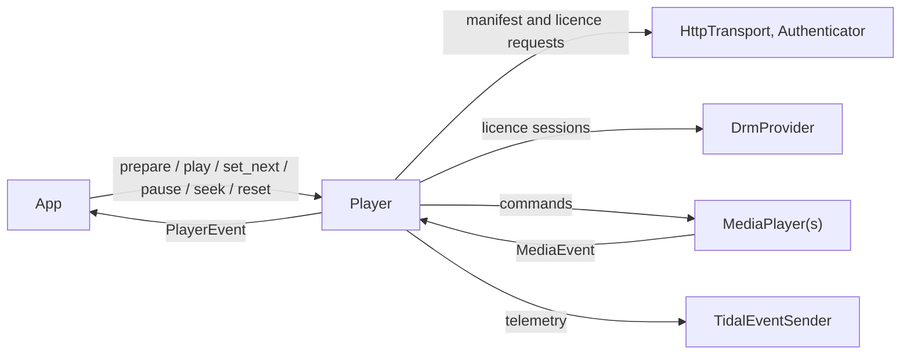

# Player

The player crate is the shared playback core for TIDAL apps. It owns what every platform
would otherwise implement on its own: fetching manifests and DRM licences from the TIDAL
backend, ordering and cancelling playback commands, moving from one item to the next
(sequentially or with a crossfade), tracking playback state and reporting playback
telemetry.

The host app owns what is platform specific: the HTTP stack, credentials, the DRM module
(CDM), the media engine and delivery of telemetry. It provides these through a small set of
traits, called ports, and receives player state through a callback.

The same API is used from Rust and, with the `uniffi` feature, from Swift, Kotlin and
browser TypeScript through generated bindings.

## How it fits together



| Concept | Role |
|---|---|
| `Player` | The entry point. Runs commands one at a time, in order, and reports `PlayerEvent`s to the host's `PlayerEvents`. |
| `PlaybackSeed` | The result of `Player::prepare`: a manifest and, if the DRM provider preloads, a licence. A seed can be played many times. |
| `MediaItem` | One playback of a seed, as the host's media player sees it. Its telemetry is sent when it is released. |
| `MediaPlayer` | The host's media engine. Plays a current item and an optional staged next item, and reports what happens as `MediaEvent`s. |

## Playing content

1. The app calls `prepare(product)` early, for example when a screen opens, and keeps the
   returned seed.
2. `play(seed)` replaces whatever is playing with the seed. Failures are returned and also
   arrive as `StateChanged(Failed)`.
3. `set_next(Some(seed))` stages the following item. When the current item ends, the player
   moves to it without app involvement. An explicit skip is `play(next_seed)`.
4. The media player reports observations such as `Started`, `Position`, `Ended` or `Failed`,
   and the player turns them into `PlayerEvent`s and telemetry.

Commands run in order. `play` and `reset` cancel the work in progress and discard earlier
queued commands.

Without a crossfade, one media player plays the current item and advances to the staged next
item on its own. With `PlayerConfig::crossfade`, the player uses two media players and fades
between them.

From Rust, construct the player inside a Tokio runtime with the host's port
implementations:

```rust
use std::sync::Arc;
use std::time::Duration;

use player::{
    AudioFormat, ManifestConfiguration, ManifestType, ManifestUsage, MediaProduct, Player,
    PlayerConfig, PlayerDependencies, PlayerEvent, PlayerEvents, TrackManifestConfiguration,
    UriScheme,
};

struct Events;

impl PlayerEvents for Events {
    fn on_event(&self, event: PlayerEvent) {
        match event {
            PlayerEvent::CurrentItemChanged { item, state }
            | PlayerEvent::StateChanged { item, state } => println!("{item:?}: {state:?}"),
            PlayerEvent::PositionChanged { position, .. } => println!("at {position:?}"),
        }
    }
}

let player = Player::new(
    PlayerConfig {
        base_url: "https://openapi.tidal.com/v2".into(),
        manifest_configuration: ManifestConfiguration {
            track_configuration: TrackManifestConfiguration {
                manifest_type: ManifestType::Hls,
                audio_formats: vec![AudioFormat::AacLc],
                adaptive: false,
                uri_scheme: UriScheme::Https,
                usage: ManifestUsage::Playback,
            },
            ..Default::default()
        },
        crossfade: None,
    },
    PlayerDependencies {
        player_events: Arc::new(Events),
        media_factory,
        http_transport,
        authenticator,
        drm_provider,
        event_sender,
    },
);

let seed = player.prepare(MediaProduct::Track { id: "1".into() });
player.play(seed).await?;
player.set_next(Some(player.prepare(MediaProduct::Track { id: "2".into() }))).await?;
player.seek(Duration::from_secs(30)).await?;
player.pause().await;
```

## Design decisions

- **The core decides; the host reports facts.** Ordering, advancement, crossfade, retries
  and telemetry are implemented once in Rust. Adapters execute commands and report what
  their engine did, so every platform behaves the same.
- **All backend HTTP happens in the core, including certificates and licences.**
  Authentication, retries and telemetry then apply uniformly. The platform CDM only creates
  challenges and installs licences.
- **Preparation is separate from playback.** A seed can be prepared before the user presses
  play and reused, so playback does not wait for the manifest and licence.
- **Crossfade uses two media players.** Media engines do not need to support fading or
  queuing; one that cannot queue an item rejects `set_next`, and the host enables the
  crossfade instead.

## Implementing an adapter

A host constructs the player with a `PlayerConfig` and these ports:

| Port | What the host provides |
|---|---|
| `HttpTransport` | Executes an HTTP request and returns status and body. The core adds authentication and retries. |
| `Authenticator` | Returns the current access token, and a refreshed one when the backend answers 401. |
| `DrmProvider` / `LicenseSession` | Wraps the platform CDM: creates challenges and installs licences the core fetched. |
| `MediaPlayerFactory` / `MediaPlayer` | Creates media engines and plays items on them. |
| `TidalEventSender` | Queues finished telemetry events for delivery. Must not block. |
| `PlayerEvents` | Receives `PlayerEvent`s for the app. |

The port traits in `src/platforms/` are the contract. The [iOS](../../platforms/ios/PLAYER.md),
[Android](../../platforms/android/PLAYER.md) and [web](../../platforms/web/player/README.md)
adapters and the fakes in `tests/support/` are working references. Points adapters most often
get wrong:

- Each item gets at most one terminal event, `Ended` or `Failed`. `Position` events drive
  the crossfade, so report them regularly while playing.
- `dispose` retires a media player for good and must stop platform work and callbacks
  itself.
- A command the core has cancelled can still arrive late. Ignore it.
- With a preloading `DrmProvider` the core installs the licence before the item reaches the
  media player. Otherwise the media player asks the item for the certificate and licence
  when its engine needs them. The DRM provider and the media factory are a matched pair.
- `PlayerEvents` callbacks may call the player but must return promptly. Hold the player
  weakly to avoid an ownership cycle.

## Building and testing

From the repository root:

```sh
cargo test --locked -p player
cargo test --locked -p player --features uniffi
tools/test-player-bindings.sh [--swift] [--kotlin]
```

The bindings script generates the Swift and Kotlin bindings and checks that a `Player`
with fake ports reaches `Playing` on each. It needs Xcode, a JDK and Node. The web
bindings are tested by the [web player](../../platforms/web/player/README.md) browser tests.

Contributor rules are in [AGENTS.md](AGENTS.md).
